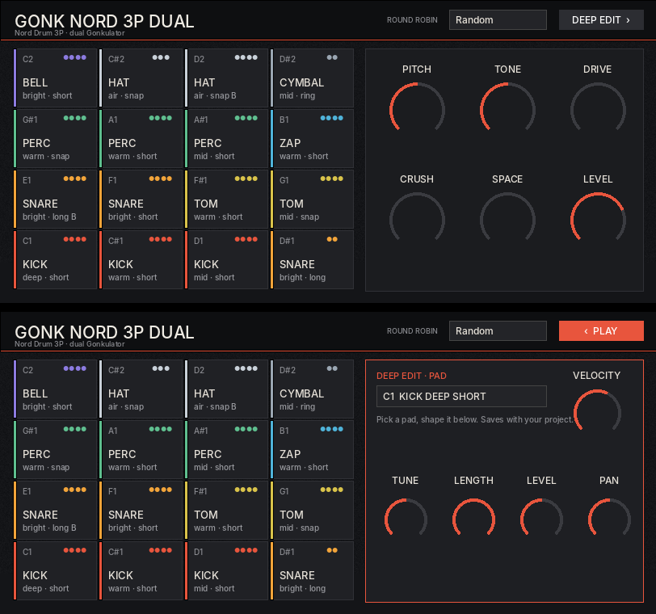

# Gonk Sampler

Long hardware recordings in → playable Decent Sampler instruments + sorted one-shot packs out.
Built around the Nord Drum 3P through the Gonkulator at GizmoTown.

## Quick start

    pip3 install numpy scipy soundfile librosa scikit-learn pillow matplotlib mido
    python3 pipeline/gonk.py take.wav --name "Gonk Nord 3P Dual" --subtitle "Nord Drum 3P · dual Gonkulator"

Outputs `<Name>.dslibrary` (drag onto Decent Sampler) and `<Name>_OneShots.zip`.
Check `gonk_out/_work/<take>/contact.png` before shipping a pack.

## Layout

| Path | What |
|---|---|
| `pipeline/gonk.py` | one command: slice → curate → build |
| `pipeline/gonk_slice.py` | onset detection, re-trigger cuts, tail trim, per-slice features |
| `pipeline/gonk_curate.py` | cleanliness scoring, sound families, 16-pad selection with round robin |
| `pipeline/gonk_build.py` | loudness matching, `.dspreset` (RR modes, deep edit page, drive/crush buses), art, packaging |
| `pipeline/contact_sheet.py` | spectrogram sheet of every pad's RR hits |
| `pipeline/mock_ui.py` | rough preview render of the preset UI (Decent Sampler itself is the real test) |
| `session/` | Nord Drum 3P sampling-session MIDI clip + hit map |

## Sampling session (Nord Drum 3P)

`session/Nord3P_Session_80bpm.mid` — set Ableton to **80 BPM** (1 bar = 3 s, one hit per bar).
MIDI channel 10 (Nord global default), notes 60/62/64/65/67/69 (channels 1–6),
6 velocities (20/45/70/95/115/127) × 4 hits per channel, 2 empty bars between channels. 8:00 per pass.

- Bar 1 is a sync hit — always start passes from bar 1 and keep it in the recording.
- Re-trigger the clip once per drive setting. Split the Nord output on the first pass to get Clean + Low together.
- Name files `KIT1_clean.wav`, `KIT1_low.wav`, `KIT1_med.wav`, `KIT1_high.wav`, `KIT1_bonkers.wav`.

Regenerate with different settings: edit the constants at the top of `session/make_session_midi.py`.

## Decent Sampler notes learned the hard way

- The background image is stretched behind DS's own header bar — never put layout in it. All boxes/labels are `<rectangle>`/`<label>` elements.
- On load DS fires every control's bindings in file order; the DEEP button must come after the pad menu.
- Wave shaper isn't transparent at minimum, so DRIVE and CRUSH are parallel buses (dry signal untouched).

## Roadmap

- [ ] MIDI-map slicing mode (use `session/*_map.json` instead of onset detection)
- [ ] Velocity layers (loVel/hiVel per layer, RR within each layer)
- [ ] Drive selector: Clean / Low / Med / High / Bonkers (group sets switched by menu, loudness-matched)
- [ ] Chromatic preset for tonal hits
